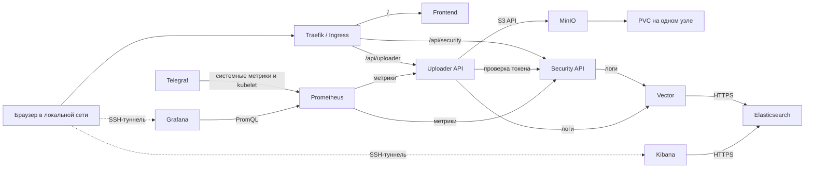
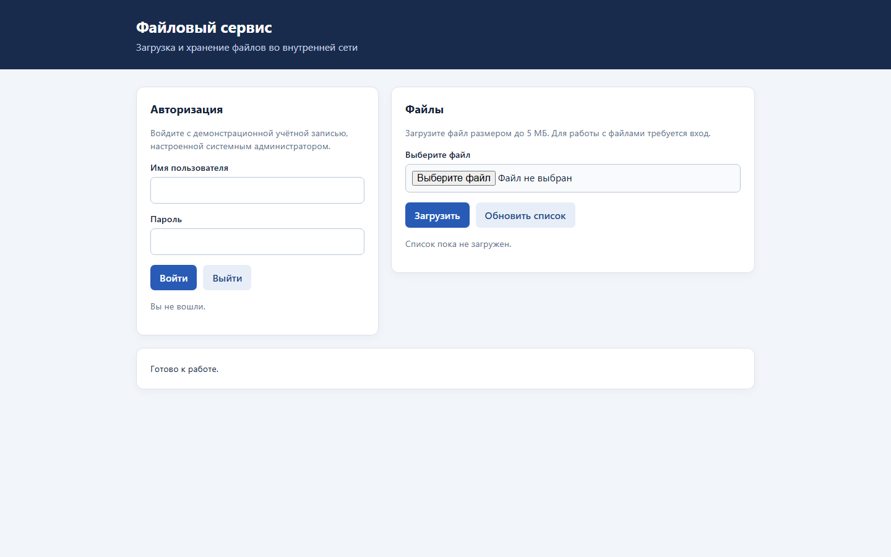
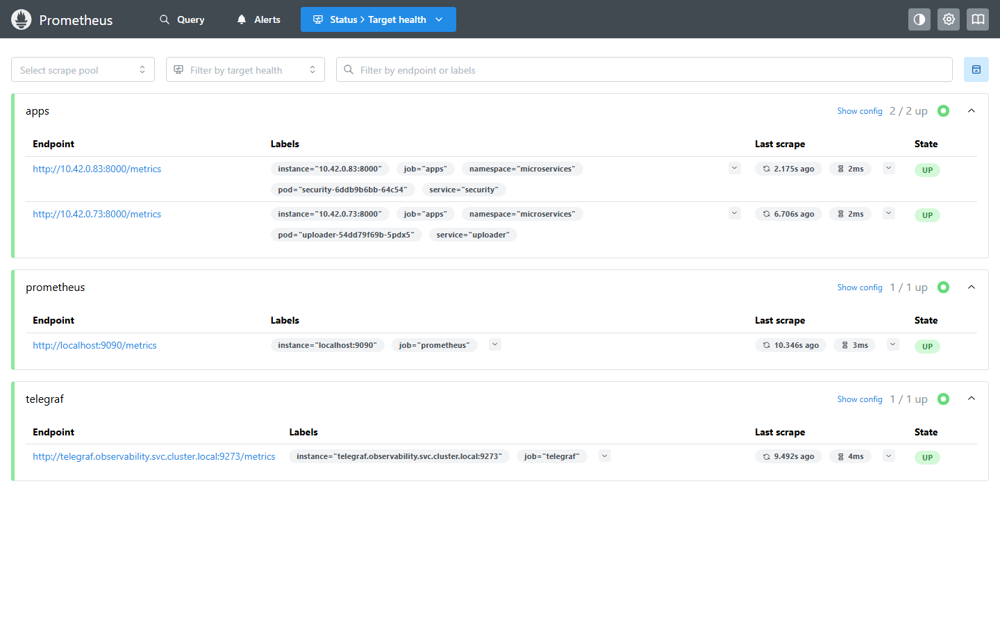

# Microservices Infrastructure & Observability

**Внутренняя инфраструктура микросервисов**

Внутренняя инфраструктура для работы с файлами: пользователь входит с демонстрационной учётной записью и работает с файлами через единую точку входа Traefik. Security проверяет учётные данные и выдаёт ограниченный по времени токен; Uploader проверяет его через Security и сохраняет объекты в MinIO. Исходный код и конфигурация рассчитаны на один узел K3s.

> Проверки от 5–10 ноября 2026 года: на одном узле K3s работали приложение, мониторинг и централизованное логирование Vector → Elasticsearch → Kibana. Проверены сайт, авторизация, файловые операции, метрики и прохождение событий в Elasticsearch. Подробности и ограничения: [этапы 0–1](docs/test-results/stage-0-1.md), [этап 2](docs/test-results/stage-2-monitoring.md), [этап 3](docs/test-results/stage-3-logging.md), [проверка HPA](docs/test-results/2026-11-10-hpa.md), [нагрузка API](docs/test-results/2026-11-10-api-load.md). Текущее состояние необходимо проверять отдельно.

Повторная [проверка после перезапуска 7 ноября](docs/test-results/2026-11-07.md) включает состояние приложения и мониторинга при лимите виртуальной машины 5000 МБ.

[Проверка перезапуска со стеком логирования](docs/test-results/2026-11-07-reboot.md) и [план дальнейших работ](docs/plan.md) описывают фактическое восстановление и следующие задачи.

После настройки startupProbe выполнена ещё одна [проверка запуска](docs/test-results/2026-11-07-startup-probes.md).

## Архитектура



| Технология | Назначение и статус |
| --- | --- |
| K3s, Kubernetes | K3s v1.37.2+k3s1 установлен на одной ноде; Node, PVC и четыре Pod были готовы на момент проверки 5 ноября 2026 года. |
| Traefik | Встроенный контроллер K3s был готов на момент проверки; отдельный экземпляр не устанавливался. |
| Python, FastAPI | Сервисы авторизации и работы с файлами; авторизация демонстрационная. |
| MinIO | S3-совместимое объектное хранилище с внутренним Service и PVC; загрузка, скачивание и сохранность тестового объекта проверены. |
| Prometheus client | Метрики запросов, задержки и загрузок приложений. |
| pytest | Локальные API-тесты. |
| Telegraf, Prometheus, Grafana | Мониторинг развёрнут и проверен 5 ноября 2026 года; актуальное состояние требуется проверить. |
| Vector, Elasticsearch, Kibana | Развёрнуты в namespace `logging`; проверены сквозная доставка двух событий, API Kibana и доступ через SSH-туннель. |

Ingress направляет `/` во frontend, `/api/security` в Security и `/api/uploader` в Uploader. Сервисы принимают полные префиксы без их удаления. Внутренние health и metrics endpoints не публикуются через Ingress. В Kubernetes MinIO имеет только ClusterIP Service; NetworkPolicy ограничивает входящий трафик подами Uploader при работающем сетевом контроллере политик. При проверке подключения к MinIO из Uploader `connect_ex` вернул 0, из Security — 111; это результат конкретной проверки, а не полный аудит сетевой изоляции.

## Развёртывание после диагностики и согласования

Сначала проверьте ОС, ресурсы, существующие службы, занятость портов и наличие K3s на целевой машине. Установка K3s, импорт образов, создание Secret и ресурсов Kubernetes изменяют сервер и выполняются только после отдельного разрешения. Не устанавливайте второй Traefik или Metrics Server. Подготовка предполагает одну Linux-ноду с работающим K3s, включённым Traefik, работающим default StorageClass, `kubectl` и OpenSSL. Никакие данные кластера или PVC не удаляются приведёнными командами.

1. На машине Linux x86-64 с Docker Engine, Git, curl, tar и sha256sum выполните из корня проекта `bash scripts/build-images.sh`. Скрипт собирает четыре образа, включая MinIO из закреплённого исходного коммита, и сохраняет архив `microservices-images.tar`. Он не создаёт публичный registry. Для получения базовых образов, исходников MinIO и зависимостей сборки нужен доступ к соответствующим источникам. Скрипт скачивает официальный архив Go во временный каталог, проверяет SHA-256 и компилирует MinIO без установки Go в систему; для итогового образа используется legacy Docker builder, buildx и make не требуются. Все четыре образа собраны и импортированы на целевом сервере.
2. После проверки SSH host key и разрешения перенесите архив на сервер по SSH и импортируйте в containerd: `sudo k3s ctr -n k8s.io images import /путь/microservices-images.tar`. Имена образов и `imagePullPolicy: Never` согласованы в манифестах.
3. На машине с настроенным доступом `kubectl` к нужному кластеру выполните `kubectl apply -f kubernetes/base/namespace.yaml`, затем `bash scripts/create-secrets.sh`. Скрипт запросит демонстрационные учётные данные без отображения пароля, создаст случайные ключи и откажется перезаписывать существующий Secret. Альтернативный `scripts/create-generated-secrets.sh` создаёт случайные значения и сохраняет защищённую копию вне репозитория. Во время развёртывания 5 ноября 2026 года на целевом сервере создан Secret с логином `demo`; пароль можно посмотреть **в локальной консоли сервера**, выполнив `sudo cat /home/codex/.local/state/microservices-observability/secrets/DEMO_PASSWORD`; не отправляйте его в чат. Сохраните учётные данные MinIO в надёжном хранилище до переноса PVC или пересоздания Secret; их смена без плана может лишить доступа к объектам. Kubernetes Secret сам по себе не является полноценным хранилищем секретов для production.
4. Примените `kubectl apply -k kubernetes/base` и выполните `bash scripts/check-cluster.sh`. Проверяйте целевой контекст `kubectl` перед командами. 5 ноября 2026 года на целевом сервере применили манифесты, а главная страница по адресу `http://192.168.1.151/` вернула HTTP 200 при запросе с Windows.

По результатам проверки 5 ноября 2026 года DNS, local-path-provisioner, Metrics Server и Traefik достигли состояния Ready; namespace и Secret были созданы. PVC 5 ГиБ находился в состоянии Bound; все четыре Pod приложения были готовы, число их рестартов — 0. Четыре образа сохранены также в архиве `/var/lib/rancher/k3s/agent/images/microservices-observability-images.tar`; повторный запуск ВМ с этим архивом тогда не проверялся. Для проверки используйте `sudo systemctl status k3s --no-pager`, `sudo k3s kubectl get nodes -o wide`, `sudo k3s kubectl get pods -A` и `sudo k3s kubectl -n microservices get pvc`; для диагностики — `sudo k3s kubectl -n microservices get pods,events` и `sudo k3s kubectl -n microservices logs deployment/<имя>`. Не удаляйте PVC или существующие службы для устранения проблемы без анализа.

## Проверки

В изолированном окружении Python установите зависимости из `services/security/requirements.txt`, `services/uploader/requirements.txt` и pytest, затем выполните `python -m pytest tests`. Локально прошли 9 тестов; они используют подмены внешних зависимостей. На реальной системе с Windows проверены HTTP 200 главной страницы, вход и проверка токена, HTTP 401 для неверного токена, загрузка тестового файла с HTTP 201 и скачивание с HTTP 200 с совпадением содержимого; файл 5 МиБ + 1 байт отклонён с HTTP 413. Тестовый объект сохранился после последовательного пересоздания Uploader и MinIO. Контроллер восстановил удалённый frontend Pod; сайт снова вернул HTTP 200. Подробности, включая обнаруженный временный 502, приведены в отчёте.

Проверку файлового сценария можно повторить с помощью `python scripts/smoke-test.py --username-file <путь-к-имени> --password-file <путь-к-паролю>`: скрипт читает демонстрационные учётные данные из отдельных файлов и создаёт тестовый объект в MinIO, не удаляя его. Файлы учётных данных нужно хранить с ограниченным доступом вне репозитория; пароль и токен в отчёт не заносите. На сервере скрипт завершился PASS. Деструктивные и нагрузочные испытания требуют отдельного согласования в рамках задания.

Результаты последних проверок: [HPA 1→2→1](docs/test-results/2026-11-10-hpa.md), [небольшой тест API](docs/test-results/2026-11-10-api-load.md), [алерт на отдельном Prometheus](docs/test-results/2026-11-10-alert.md) и [буфер Vector на отдельном процессе](docs/test-results/2026-11-10-vector.md). Два последних испытания не имитируют отказ работающего кластера.

Текущее состояние на сервере можно проверить без изменения ресурсов:

```bash
sudo k3s kubectl get nodes
sudo k3s kubectl get pods -A
sudo k3s kubectl -n microservices get hpa
sudo k3s kubectl top nodes
free -h
df -h / /var/lib/codex-elasticsearch
```

Для ограничения доступа к портам TCP 6443/10250 и UDP 8472 настроена отдельная цепочка firewall с правилами IPv4 для loopback, локальной сети и сети Pod, а для IPv6 — loopback. Допускаемый цепочкой трафик далее обрабатывается остальными правилами firewall. Состояние службы и правила можно посмотреть командами `sudo systemctl status codex-k3s-api-firewall.service --no-pager`, `sudo iptables -S CODEX_K3S_API` и `sudo ip6tables -S CODEX_K3S_API`. Доступ извне и проброс портов на маршрутизаторе не проверены; не считайте защиту от внешнего доступа подтверждённой без такой проверки.

## Мониторинг

В namespace `observability` развёрнуты Telegraf v1.40.2, Prometheus v3.15.1 и Grafana v13.3.0. Telegraf получает системные и контейнерные метрики через `/proc` и kubelet API с проверкой TLS, без Docker socket. Prometheus обнаруживает готовые Pod Security и Uploader по отдельности, чтобы при масштабировании не смешивать счётчики разных экземпляров. Его сервисной учётной записи разрешено только просматривать список Pod пространства приложения; доступ к секретам и другим пространствам не предоставлен. Дашборды DevOps и Business используют реальные метрики.

Правило `AppServiceDown` срабатывает, если у службы нет доступной цели метрик или обнаружение целей не работает в течение 30 секунд. Поведение проверено сценариями `promtool` и в отдельном Prometheus на искусственной цели: [отчёт](docs/test-results/2026-11-10-alert.md). Прежний живой тест в кластере проводился до перехода на обнаружение Pod. Alertmanager и внешняя доставка уведомлений не настроены.

Для Security настроен HPA: от одной до двух реплик при целевой загрузке CPU 75% от запроса контейнера 50m. Метрики для HPA поступают от Metrics Server, а Prometheus отдельно собирает метрики каждого готового Pod. Увеличение стабилизируется в течение 60 секунд, уменьшение — в течение 300 секунд; окно стабилизации не гарантирует конкретное время реакции. Цикл 1→2→1 проверен с ограниченной CPU-нагрузкой; обе реплики были доступны Prometheus. Подробности — в [отчёте](docs/test-results/2026-11-10-hpa.md).

Конфигурация состоит из трёх отдельных Kustomize-наборов. Telegraf использует путь узла `/var/lib/codex-elasticsearch`: перед первым запуском подготовьте и проверьте том логирования, namespace `observability` и его identity по [инструкции контроля дисков](monitoring/README-disk.md). Иначе Telegraf может не запуститься или сообщать об отсутствии тома. Пространство имён для первого запуска можно создать командой `sudo k3s kubectl apply -f monitoring/namespace.yaml`. Применяйте identity только после проверки устройства; повторное создание существующих данных не предусмотрено.

Затем для нового развёртывания на K3s выполните из корня репозитория следующие команды **от пользователя `codex` с разрешённым sudo** после проверки контекста:

```bash
sudo k3s kubectl apply -f monitoring/prometheus/discovery-rbac.yaml
sudo k3s kubectl apply -k monitoring
sudo k3s kubectl apply -k monitoring/access
KUBECTL_MODE=k3s bash monitoring/access/create-grafana-secret.sh
sudo k3s kubectl apply -k monitoring/grafana
KUBECTL_MODE=k3s bash monitoring/access/create-portforward-kubeconfig.sh
```

Первый набор создаёт namespace и ресурсы Prometheus и Telegraf, второй — ограниченные права для туннеля. Секрет Grafana создаётся до её Deployment. Скрипты создания секрета и kubeconfig не перезаписывают существующие файлы или Secret. `create-portforward-kubeconfig.sh` записывает файлы относительно `$HOME`, поэтому для описанного далее пути его необходимо запускать от `codex`, а не от root. Токен и kubeconfig с ограниченными правами хранятся вне Git; административный kubeconfig не копируется. Если выделенный SSH-ключ ещё не допускает туннели, при разрешении владельца можно запустить от `codex` `python3 monitoring/access/enable-local-forwarding.py <путь-к-публичному-ключу>`: скрипт изменяет только точно совпадающую запись с исходной опцией `restrict` и сохраняет резервную копию `authorized_keys`.

Для доступа из Windows используется SSH-туннель к loopback, интерфейсы мониторинга не публикуются через Ingress. После проверки ключа сервера и настройки ограниченного доступа к туннелю запустите из корня репозитория в отдельных окнах PowerShell, подставив пути к выделенному ключу и файлу проверенных ключей серверов:

```powershell
.\monitoring\access\open-monitoring.ps1 -Service grafana -IdentityFile '<путь-к-ssh-ключу>' -KnownHostsFile '<путь-к-known_hosts>'
.\monitoring\access\open-monitoring.ps1 -Service prometheus -IdentityFile '<путь-к-ssh-ключу>' -KnownHostsFile '<путь-к-known_hosts>'
```

Оставьте окна открытыми: Grafana доступна на `http://127.0.0.1:13000/`, Prometheus — на `http://127.0.0.1:19090/`. Оба туннеля проверялись 5 ноября 2026 года; их текущее состояние и работа после перезапуска ПК не подтверждены. Учётные данные Grafana хранятся на сервере вне Git: пароль можно посмотреть в локальной консоли командой `sudo cat /home/codex/.local/state/microservices-observability/monitoring/password`; не отправляйте его в чат. Токен для туннеля, выданный при проверке, истекает 5 декабря 2026 года в 15:33 по времени Екатеринбурга, после чего его потребуется обновить с административными правами.

Для Prometheus запрошен PVC 2 ГиБ, для Grafana — 1 ГиБ; retention Prometheus — 2 дня или 768 MB. Размер PVC не является жёсткой квотой local-path-provisioner, а WAL и head могут превышать порог retention. В замере 5 ноября все три Pod мониторинга были готовы, доступно было около 4,3 ГиБ RAM и 9,2 ГиБ на диске; это моментальные значения. Детали проверки, ранних перезапусков Grafana и ограничений находятся в [отчёте этапа 2](docs/test-results/stage-2-monitoring.md).

## Логирование

7 ноября 2026 года Elasticsearch, Vector и Kibana работали в namespace `logging`. Проверены HTTPS, разграничение доступа и доставка событий в Elasticsearch; пользователь подтвердил вход в Kibana. 8 ноября добавлены правила Prometheus для заполнения и доступности корневой файловой системы и тома логов; внешняя доставка оповещений не настроена. Подробности — в [отчёте этапа 3](docs/test-results/stage-3-logging.md) и [проверке дисков](docs/test-results/2026-11-08-disk.md). В отдельном тесте Vector доставил событие из дискового буфера после восстановления искусственного приёмника и перезапуска процесса: [результаты](docs/test-results/2026-11-10-vector.md). Отдельные инструкции описывают подготовку [Elasticsearch](logging/elastic/README.md), [Vector](logging/vector/README.md), [Kibana](logging/kibana/README.md) и [контроль тома](monitoring/README-disk.md).

Для доступа из Windows откройте PowerShell в корне репозитория и подставьте пути к выделенному SSH-ключу и файлу проверенных ключей сервера:

```powershell
.\logging\access\open-kibana.ps1 -IdentityFile '<путь-к-ssh-ключу>' -KnownHostsFile '<путь-к-known_hosts>'
```

Пока окно открыто, Kibana доступна по `http://127.0.0.1:15601/`. Учётная запись только для чтения хранится на сервере: её имя и пароль можно посмотреть в локальной консоли командами `sudo cat /var/lib/codex-logging-secrets/kibana-reader-username` и `sudo cat /var/lib/codex-logging-secrets/kibana-reader-password`. Не отправляйте эти данные в чат. Скрипт использует ограниченный kubeconfig мониторинга; токен имеет право создавать port-forward к Pod в namespace `logging`, а не только к Pod Kibana, поскольку Kubernetes RBAC не ограничивает это право по метке. Доступ к ключу и kubeconfig необходимо защищать.

## Ограничения и развитие

Система предназначена для доверенной локальной сети: HTTP передаёт учётные данные и токены без шифрования. Для production нужны HTTPS, полноценная система идентификации, ограничение частоты запросов, отдельные права для хранилища, управление секретами и аудит. Одна нода и локальный PVC не обеспечивают отказоустойчивость и резервное копирование. **Запрос PVC на 5 ГиБ не является жёсткой дисковой квотой:** local-path-provisioner её не обеспечивает, поэтому необходимо следить за реальным свободным местом на корневом разделе. Лимит отдельного файла — 5 МиБ; учётные данные и данные только демонстрационные. MinIO собран из закреплённого исходного коммита [релиза с исправлением безопасности 2025-10-15](https://github.com/minio/minio/releases/tag/RELEASE.2025-10-15T17-29-55Z) и запущен на базе `python:3.12-slim`. Проект MinIO опубликован под AGPLv3; его исходный репозиторий архивирован, а базовые образы сборки пока не закреплены по digest. Перед расширением использования или переходом в production требуется оценить поддержку, лицензирование, актуальные исправления и воспроизводимость сборки. Не открывайте MinIO, Kubernetes API и будущие интерфейсы наблюдаемости в интернет.

Дальнейшие работы: проверить контролируемый разрыв доставки логов на действующем кластере и длительное исполнение политики хранения, а также оценить потребление при продолжительной нагрузке. Резервное копирование отложено по решению владельца; восстановление данных после потери хранилища не обеспечено. PostgreSQL, RabbitMQ и обработка заказов возможны в roadmap, но сейчас не устанавливаются. Критерии завершения текущего проекта приведены в [плане](docs/plan.md).

## Интерфейсы

Состояние интерфейсов при проверке 10 ноября 2026 года:





## Документация

[Microservices.io](https://microservices.io/) · [Martin Fowler: Microservices](https://martinfowler.com/articles/microservices.html) · [K3s](https://docs.k3s.io/) · [Traefik](https://doc.traefik.io/traefik/) · [MinIO](https://min.io/docs/) · [Vector](https://vector.dev/docs/) · [Elastic](https://www.elastic.co/docs) · [Prometheus](https://prometheus.io/docs/) · [Grafana](https://grafana.com/docs/) · [Telegraf](https://docs.influxdata.com/telegraf/)
